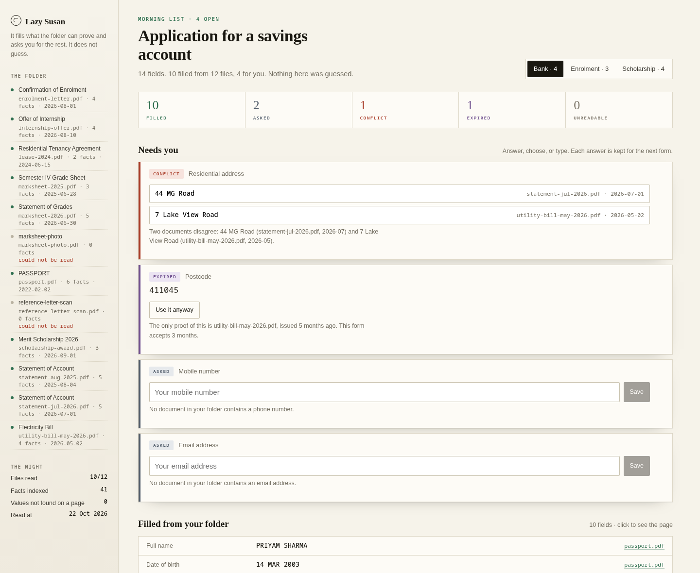

# Lazy Susan

Point it at a folder of documents. It fills a form with what the folder can prove, and asks you
for the rest. It does not guess, and it does not write a value it cannot point at.

Every filled field in the interface has a **Show me** button. It opens the page and draws a box
around the words the value was read from. If there is no box, the field does not get filled.



## Five verdicts

| Verdict | Meaning | What the file gets |
|---|---|---|
| `FILLED` | One or more documents say the same thing, and the words are on the page | the value |
| `ASKED` | Nothing in the folder carries this | an empty field and a question |
| `CONFLICT` | Two documents disagree, both are legible | an empty field and a choice |
| `EXPIRED` | The only proof is older than the form allows | an empty field and the date |
| `UNREADABLE` | The file is there but has no text layer, or the value cannot be trusted | an empty field and a reason |

A value you type yourself is accepted, but it is marked **your word** and it is greyed out in the
interface, because it is not the same kind of thing as a value read off a page.

## Quick start

```bash
pnpm install
pnpm night      # build the fixture PDFs, read them, freeze the run for the browser
pnpm start      # http://localhost:4757
```

`pnpm night` needs `poppler-utils` (`pdftotext`, `pdftoppm`). `pnpm warm` needs Ollama with
`gemma3:1b` pulled; without it the app falls back to label rules and a template paragraph, and
says so.

```bash
pnpm test       # 76 tests: resolver, essay check, journal, ledger, reader, tracing, portal,
                #           token checks, voice, answers mirror, deployment blueprint
pnpm report     # every number quoted in the write-up, computed from these files
```

## What runs where

| Piece | Path | Job |
|---|---|---|
| `packages/core` | pure TypeScript | the five verdicts, the essay check, the ledger, the fill plan |
| `packages/reader` | Node | `pdftotext -bbox-layout` → words → labels → facts with a rectangle |
| `packages/corpus` | Python | makes twelve documents and three forms, plus a ground-truth file |
| `providers/gemma` | Node | the local model: form labels, and the paragraph |
| `providers/temporal` | Node | the night as a durable workflow, one activity per document |
| `providers/sentry` | Node | tracing, off unless `SENTRY_DSN` is set |
| `providers/browserbase` | Node | types a resolved form into a page, locally or in a hosted browser |
| `providers/auth0` | Node | verifies bearer tokens when a tenant is configured |
| `providers/elevenlabs` | Node | reads the morning list aloud, when a key exists |
| `providers/atlas` | Node | an off-machine copy of the answers you typed |
| `providers/render` | Node | reads the deployment blueprint so the health route can report it |
| `apps/brain` | Hono | reads the folder, keeps the journal, fills PDF and HTML |
| `apps/web` | React | the morning list, the page peek, the ledger |

The browser does not ask the server what it should think. `apps/web` runs the same `core` code
over a frozen copy of the facts, so moving the tolerance slider re-decides every field in front of
you.

## How a value gets in

1. `pdftotext -bbox-layout` gives every word and its rectangle.
2. Words sharing a baseline are grouped into lines. (The tool splits a wide gap into two blocks,
   which is how "Full name" and "PRIYAM SHARMA" end up apart.)
3. A small table of labels maps lines to facts: `Passport number` → `identity.id_number`, and so on.
4. The value is searched for again in the page text. The rectangle is the union of the words it
   matched. **If the search fails, the fact is dropped and counted.** On this corpus that count is
   zero out of forty-one.
5. A resolver decides between sources: better document kind first (a passport beats an award
   letter for a name), then more recent.

Nothing in steps 1–5 involves a model. That is deliberate: a value that is literally on the page
does not need one, and a model that mistypes `PRIYAM` as `PRAYAM` produces a fact that cannot be
located, which is worse than no fact.

## What the model is for

Two things a table of regular expressions cannot do.

**Reading a form it has never seen.** The form's field labels go to the local model, which maps
each one to a fact key. Measured on 39 labels across the three forms: 25 exact, 4 repaired by
code (a stray `person.` prefix), 10 caught by the label rules when the model answered with
something that was not a key, 0 left unmapped. A 1B model is not good at this; it is good enough
that the rules only have to cover a quarter.

**Writing the paragraph.** The model drafts the free-text answer. Then code splits it into
sentences, works out which facts each sentence is leaning on, and strikes any sentence containing
a number that is not in those facts. The model wrote *"three years of experience as a Software
Engineering Intern"*. There is no such number anywhere in the folder — the internship starts in
September and the year of study is 3, which is a different claim — so that sentence is struck and
shown crossed out, with the reason. Five sentences survive, two do not.

## The ledger

Every change is an entry in an append-only journal: one per document read, one per answer, one per
conflict resolved. Each entry stores the hash before and after. The interface prints the current
index hash, and **Undo** replays the journal without the last entry. The hash comes back identical,
which is the only proof of "exact undo" that means anything.

## The night, as a workflow

A night is twelve documents and one bad moment: someone closes the laptop. So the run is a Temporal
workflow, `nightRun`, with one activity per document. The worker holds no state that matters. The
server holds the position.

```bash
temporal server start-dev          # local, no account
pnpm build && pnpm worker          # in one terminal
pnpm night:durable                 # in another
pnpm verify:night                  # every document read exactly once
```

The activity is the part that has to be careful. It reads one PDF, writes one extraction file, and
appends one row to `apps/brain/out/night-ledger.jsonl`. The row is keyed by the digest of the
document's bytes, so an activity that is retried after a crash finds its own earlier work and writes
nothing. Idempotence is a property of the record, not a promise from the scheduler.

Tested by killing it. The worker was killed with `kill -9` after four of twelve documents, left dead
for eight seconds, and started again:

```
documents         12
ledger rows       12
distinct digests  12
duplicates         0
missing            0
rows by attempt   attempt 1: 11, attempt 2: 1
ok: every document read exactly once
```

One row came from a second attempt. That is the document that was in flight when the process died.
Nothing was read twice.

## The folder

All twelve documents are synthetic, generated by `packages/corpus/tools/make_docs.py`. Ten have
real text layers; two are images of pages with no text at all, so the app has something it
genuinely cannot read. The names, numbers and addresses are invented. The income figure and the
addresses disagree with each other on purpose, because that is what makes the conflict and expiry
verdicts real rather than decorative.

Ground truth is in `packages/corpus/ground-truth.json`: what a careful person would take from each
file. It exists so the reader can be scored instead of admired.

## What is not built

- No OCR. A photograph of a page is reported as unreadable, not guessed at.
- No portal automation against somebody else's site. A browser path exists for a page you point it
  at, and it fills the controls it was given and leaves the rest alone; it does not log in to a
  bank, and it does not press submit.
- No cloud by default. Nothing leaves the machine unless a key is set: not the documents, not the
  model call, not the trace. Temporal runs as a local dev server on `localhost:7233`.
- The model runs on this laptop, which is a slow laptop. A form mapping takes between 78 and 152
  seconds here. That is why the answers are cached and the cache is committed.

## Partner technology

Every row below is the same shape: an optional provider with a local path that runs without an
account, a contract test that exercises the real code path, and a key that switches it on. Nothing
is claimed as live until I have run it against the real service and can say what it did.

| | Status |
|---|---|
| **Gemma** (Ollama, `gemma3:1b`) | demonstrated: 39 form labels mapped, paragraph drafted, both measured above |
| **Temporal** | demonstrated: `nightRun`, one activity per document, killed mid-run and resumed with zero duplicate rows |
| **Browserbase** | wired and tested: `fillPortal` types a resolved form into a real page, reads each value back out of the DOM, attaches files, returns a screenshot. Five tests drive the actual enrolment form in a local Chrome and read each value back; a sixth checks the mode switch. With `BROWSERBASE_API_KEY` the same code path connects to a Browserbase session instead |
| **Auth0** | wired and tested: when `AUTH0_DOMAIN` and `AUTH0_AUDIENCE` exist, every `/api` route except the health check verifies the bearer token against the tenant's JWKS, issuer, audience and expiry. Nine tests sign real tokens with a generated key pair and check the ways a token should fail |
| **ElevenLabs** | wired and tested: the open fields become a short spoken script. With a key the audio comes from `ELEVENLABS_API_KEY`; without one the API returns the same script and the page reads it with its own voice, so the button is never dead |
| **MongoDB Atlas** | wired and tested against a real `mongod`: the answers you typed are mirrored, keyed by a content hash, and replayed on a new machine. The documents are not mirrored, because they never left the folder. Set `MONGODB_URI` |
| **Render** | `Dockerfile` + `render.yaml`, built and run here: the container serves the page, the three forms and the health route. `/api/health` reports which optional keys the deployment has, as booleans |
| **Sentry** | wired and tested: spans per document, per form run, per filling; no-op without `SENTRY_DSN`. A test points the SDK at a DSN on localhost and asserts the envelope carries the span name. No screenshot, because that needs an account I do not have |

No other partner is claimed. Installing an SDK is not a demonstration, and neither is a key that
arrives after the screenshot was taken.

## Licence

MIT.
